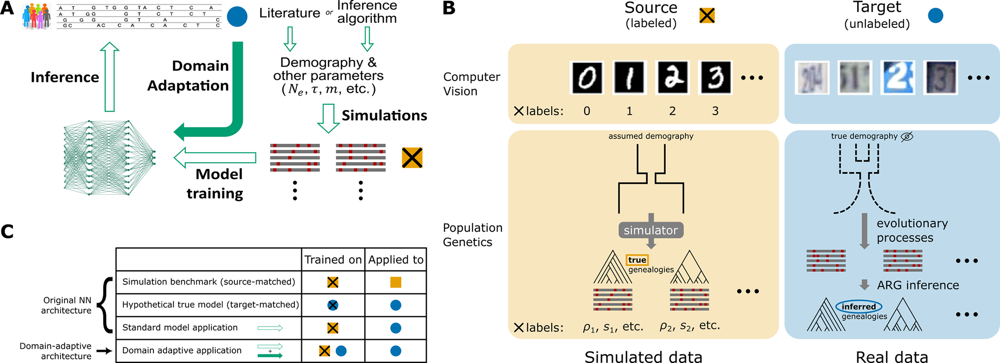

.. _dann:

Demographic misspecification and domain adaptation
==================================================

A CNN trained on simulations learns the simulated distribution of every statistic.
Demographic history changes those statistics, and some histories, such as bottlenecks
and population growth, produce neutral patterns that look like selective sweeps. When
the simulated demography (or mutation rate, recombination rate, or background selection)
does not match the real population, the empirical feature vectors fall outside the
training distribution, and the classifier can make false positive or false negative
calls without any warning.

Flex-sweep reduces this mismatch in two ways. First, every dataset is standardized
against its own distribution (:doc:`feature_vectors`), which removes differences in
the location and scale of each statistic. Second, the domain-adversarial neural network
(DANN) of `Mo and Siepel 2023 <https://doi.org/10.1371/journal.pgen.1011032>`_ trains on
two inputs at once:

* **source**: labelled simulations (``fvs-discoal``), used to learn neutral vs sweep;
* **target**: unlabelled empirical feature vectors (``fvs-vcf``), used only to make the
  learned features uninformative about whether an input is simulated or real.

A shared feature extractor feeds two heads: the sweep classifier, and a domain
classifier connected through a gradient-reversal layer. Minimising the classifier loss
while reversing the domain gradient pushes the extractor towards features that predict
sweeps but not the domain. Flex-sweep applies the same architecture to feature-vector
images instead of genealogies. If you use it, cite
`Mo and Siepel 2023 <https://doi.org/10.1371/journal.pgen.1011032>`_; their
`source code <https://github.com/ziyimo/popgen-dom-adapt>`_ is the reference
implementation.

The DANN does not replace realistic simulations. Simulate under the best demographic
model available (:ref:`shipped-models`), and use the DANN to absorb the remaining
mismatch. When the training demography is far from the truth, domain-adaptive training
can still perform worse than the plain CNN, so test it on simulations first
(:ref:`demography-misspecification`).

Command line and Python interface
---------------------------------

.. code-block:: bash

    # Train on simulations + empirical regions, then predict the empirical regions
    flexsweep dann \
        --source_data yri_sims/fvs.parquet \
        --target_data yri_vcfs/fvs_yri.parquet \
        --output_folder yri_dann \
        --seed 1

    # Predict with a trained model (reads calibration.json from the model folder)
    flexsweep dann \
        --model yri_dann/model_da.keras \
        --target_data yri_vcfs/fvs_yri.parquet \
        --output_folder yri_dann_pred

.. code-block:: python

    import flexsweep as fs

    fs_dann = fs.CNN(
        source_data="yri_sims/fvs.parquet",
        target_data="yri_vcfs/fvs_yri.parquet",
        output_folder="yri_dann",
        seed=1,
    )
    fs_dann.train_da()
    df_prediction = fs_dann.predict_da()

``train_da`` and ``predict_da`` default to the values of the ``dann`` command, so the calls
above reproduce the CLI. In particular ``preprocess`` is off in both: the feature vectors
written by ``fvs-discoal`` and ``fvs-vcf`` are already standardized.

Options
-------

.. list-table::
   :header-rows: 1
   :widths: 22 22 22 34

   * - CLI option
     - Python argument
     - Default (CLI / Python)
     - Meaning
   * - ``--source_data``
     - ``source_data``
     -
     - Labelled simulation feature vectors (``fvs-discoal``).
   * - ``--target_data``
     - ``target_data``
     -
     - Empirical feature vectors (``fvs-vcf``): used unlabelled in training, then
       predicted.
   * - ``--model``
     - ``model``
     -
     - Trained ``model_da.keras``; skips training.
   * - ``--target_ratio``
     - ``tgt_ratio``
     - ``2.0``
     - Target examples per source example in each batch.
   * - ``--max_lambda``
     - ``max_lambda``
     - ``1.0``
     - Maximum gradient-reversal strength.
   * - ``--ramp_epochs``
     - ``ramp_epochs``
     - ``30``
     - Epochs of the linear :math:`\lambda` ramp.
   * - ``--batch_size``
     - ``batch_size``
     - ``64``
     - Source mini-batch size.
   * -
     - ``learning_rate``, ``weight_decay``
     - ``5e-5``, ``1e-4``
     - AdamW with cosine decay and restarts (Python only).
   * -
     - ``patience``, ``epochs``
     - ``20``, ``1000``
     - Early stopping and maximum epochs (Python only).
   * - ``--center``, ``--windows``, ``--step``
     - ``center``, ``windows``, ``step``
     - as ``cnn``
     - Feature-vector geometry (see :doc:`cnn`).
   * - ``--preprocess``
     - ``preprocess``
     - off
     - Leave off: the feature vectors are already z-scored.
   * - ``--seed``
     - ``seed``
     - unseeded
     - Seeds Python, NumPy, TensorFlow and the data splits.

The default statistic set is the 24 statistics listed in ``CNN.train_da``.

Output
------

* ``model_da.keras``: trained model;
* ``calibration.json``: Platt scaling fitted on the held-out simulated test set and
  applied by ``predict_da``; it is learned on simulations only;
* ``<name>_da_predictions.txt``: predictions on ``--target_data``, with the same
  columns as the CNN output (:doc:`cnn`).

Training schedule
-----------------

The strength of the gradient reversal, :math:`\lambda`, grows linearly from 0 to
``max_lambda`` over the first ``ramp_epochs`` epochs and then stays at ``max_lambda``.
The classifier first learns from the labelled simulations, and the domain pressure
builds up afterwards; capping :math:`\lambda` keeps the domain objective from
dominating. Each batch draws ``tgt_ratio`` target examples per source example, so the
discriminator sees both simulated and empirical regions in every batch. After
training, the whole target dataset is predicted. Monitor the domain accuracy during
training: values near 0.5 mean the extractor no longer separates simulated from
empirical regions.

   Figure from `Mo and Siepel 2023 <https://doi.org/10.1371/journal.pgen.1011032>`_:
   neural networks, domain adaptation architecture, input data and benchmarking in
   population genetic inference.

.. _demography-misspecification:

Testing a misspecified model on simulations
-------------------------------------------

Real data have no labels, so the effect of a wrong demographic model is measured on
simulations. Simulate labelled data under a **training** model and under a different
**test** model that plays the role of the real population. Then compare a CNN trained
on the training model, a DANN trained on the training model with the test-model feature
vectors as unlabelled target, and, as an upper bound, a CNN trained on the test model
itself.

.. code-block:: bash

    # Training model and "true" model
    flexsweep simulator --sample_size 100 --demes constant --output_folder src \
        --num_simulations 10000 --nthreads 24 --seed 1
    flexsweep simulator --sample_size 100 --demes yri --output_folder tgt \
        --num_simulations 10000 --nthreads 24 --seed 2
    flexsweep fvs-discoal --simulations_path src --nthreads 24
    flexsweep fvs-discoal --simulations_path tgt --nthreads 24

    # CNN trained on the wrong model, predicting the "true" model
    flexsweep cnn --train_data src/fvs.parquet --predict_data tgt/fvs.parquet \
        --output_folder cnn_src --seed 1

    # DANN: labelled source + unlabelled target
    flexsweep dann --source_data src/fvs.parquet --target_data tgt/fvs.parquet \
        --output_folder dann_src --seed 1

    # Upper bound: CNN trained on the "true" model
    flexsweep cnn --train_data tgt/fvs.parquet --output_folder cnn_tgt --seed 1

In the predictions on ``tgt``, neutral replicates have ``s = 0`` and sweep replicates
carry their ``s``, ``t``, ``f_i`` and ``f_t``. Compare the false positive rate on
neutral replicates and the recall on sweep replicates between the three models. In a
real analysis the DANN target would be the empirical feature vectors from ``fvs-vcf``,
not simulated ones. Use separate replicates (seeds) for the target pool and for the
evaluation set when you report results.

Admixture and population structure
----------------------------------

discoal, which Flex-sweep uses for simulation, models sweeps in a single population.
With population structure (``-p``), a sweep acts only in population 0, and only when
the whole sweep is more recent than every population event; otherwise the sweep is
silently dropped. Sweeps older than an admixture event therefore cannot be simulated
with discoal. To train under admixture, simulate with a forward simulator (e.g. SLiM
with tree-sequence recording), write the replicates as ms-format files in the folder
layout of ``flexsweep simulator`` (``neutral/``, ``sweep/`` and ``params.txt.gz``), and
compute feature vectors with ``flexsweep fvs-discoal``.

The benchmark of the CNN and the DANN under misspecified demography (size change and
recent admixture) is in progress and will be added here with its results.
