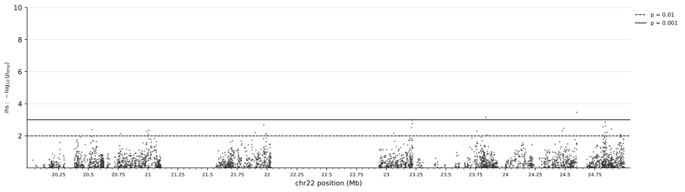

Quickstart
==========

One command runs a complete analysis on real data: it downloads YRI chr22 data from
the Flex-sweep :ref:`Zenodo record <example-data-zenodo>`, builds a polarized and
masked VCF of 50 unrelated YRI individuals, simulates a small YRI training set,
computes feature vectors, trains the CNN, predicts, and runs an outlier scan.

This run is a smoke test of the workflow, **not** a usable sweep scan: the training set
is far too small for reliable predictions. For real analyses follow :doc:`basic_usage`.

Run the example
---------------

.. code-block:: bash

    flexsweep example --output_folder yri_example --nthreads 24

This uses chr22:20,000,001-25,000,000 (GRCh38). ``--full`` uses the whole of chr22:

.. code-block:: bash

    flexsweep example --output_folder yri_chr22 --nthreads 24 --full

The command prints the step it is running (``[3/6] fvs-sims ...``) and the wall-clock
time of each step, which is also appended to ``timings.tsv``. On a rerun, a step is
skipped if it finished and its outputs still exist, so an interrupted run resumes
where it stopped and deleting a step's outputs (e.g. ``scan/``) reruns it; rerunning
a step also reruns the steps that use its outputs. ``--overwrite`` reruns everything. ``--steps`` runs a subset, e.g. ``--steps data,scan``
for the outlier scan alone (no simulations). ``--num_simulations`` (default 1000
neutral + 1000 sweep) and ``--seed`` (default 1) are the other options.

Steps
-----

.. list-table::
   :header-rows: 1
   :widths: 12 50 38

   * - Step
     - What it does
     - Output in ``yri_example/``
   * - data
     - Downloads the Zenodo record once (170 MB, md5-checked), draws 50 of the 108
       YRI (``--seed``), keeps the biallelic SNPs polymorphic in them, polarizes them
       with the great-ape MAF (``flexsweep polarize``) and removes sites in the GIAB
       difficult regions.
     - ``data/vcfs/yri_chr22_example.vcf.gz``; downloads and intermediate files in
       ``data/raw/``
   * - simulate
     - Neutral and sweep replicates under the shipped YRI model, 100 haplotypes
       (2 x 50 individuals).
     - ``sims/``
   * - fvs-sims
     - Feature vectors of the simulations.
     - ``sims/fvs.parquet``
   * - fvs-vcf
     - Feature vectors of the VCF, with the bundled deCODE map (GRCh38).
     - ``data/vcfs/fvs_yri.parquet``
   * - cnn
     - Trains the CNN on the simulations and predicts the VCF windows.
     - ``cnn/yri_predictions.txt`` (columns in :doc:`cnn`)
   * - scan
     - iHS, nSL, H12 and RAiSD :math:`\mu` outlier scan (:doc:`scan`) and two
       outlier plots: values with the top 1% highlighted, and -log10 empirical
       p-values.
     - ``scan/yri.{ihs,nsl,h12,raisd}.txt``, ``scan/yri.scan.{svg,png}``,
       ``scan/yri.scan_pvalue.{svg,png}``

The data come from the NYGC 30x 1000 Genomes phased panel
(`Byrska-Bishop et al. 2022 <https://doi.org/10.1016/j.cell.2022.08.004>`_), the
Zoonomia 447-mammal Cactus alignment
(`Zoonomia Consortium 2020 <https://doi.org/10.1038/s41586-020-2876-6>`_;
`Armstrong et al. 2020 <https://doi.org/10.1038/s41586-020-2871-y>`_) and the GIAB
v2.0 GRCh38 stratifications
(`Dwarshuis et al. 2024 <https://doi.org/10.1038/s41467-024-53260-y>`_). For other
populations or chromosomes, prepare the data as in :doc:`data_preparation`.

The same steps, one command each
--------------------------------

``flexsweep example`` runs the commands below with these options. Run them yourself
to change any option; the data step has no separate command.

.. code-block:: bash

    flexsweep simulator --sample_size 100 --demes yri --output_folder yri_example/sims \
        --num_simulations 1000 --nthreads 24 --seed 1
    flexsweep fvs-discoal --simulations_path yri_example/sims --nthreads 24
    flexsweep fvs-vcf --vcf_path yri_example/data/vcfs --recombination_map decode \
        --nthreads 24 --suffix yri
    flexsweep cnn --train_data yri_example/sims/fvs.parquet \
        --predict_data yri_example/data/vcfs/fvs_yri.parquet \
        --output_folder yri_example/cnn --seed 1
    flexsweep scan --vcf_path yri_example/data/vcfs --out_prefix yri_example/scan/yri \
        --stats ihs,nsl,h12,raisd --nthreads 24

To also normalise iHS and nSL by local recombination rate, compute the rate bins from
your data first, then pass them with ``--r_bins``:

.. code-block:: bash

    flexsweep recombination-bins --vcf_path yri_example/data/vcfs --recombination_map decode
    # prints e.g.  Recombination bins: 0.37,0.55,...  (use your own output)
    flexsweep scan \
        --vcf_path yri_example/data/vcfs \
        --out_prefix yri_example/scan_r/yri \
        --stats ihs,nsl \
        --recombination_map decode \
        --r_bins <bins printed above> \
        --nthreads 24

With only 5 Mb of data the bins are coarse; on whole genomes, compute them once from
all chromosomes.

Plot the scan
-------------

The scan step writes two figures with the four statistics stacked:
``scan/yri.scan.svg`` (values, top 1% per statistic highlighted) and
``scan/yri.scan_pvalue.svg`` (-log10 empirical p-values, lines at p = 0.01 and
0.001), each also as PNG. The SVGs keep their text as editable text; a viewer
that draws no SVG text shows them without labels, so open them in a browser or use
the PNGs. To plot yourself:

.. code-block:: bash

    flexsweep scan-plot \
        --stat yri_example/scan/yri.ihs.txt \
        --stat yri_example/scan/yri.nsl.txt \
        --stat yri_example/scan/yri.h12.txt \
        --stat yri_example/scan/yri.raisd.txt \
        --multi --out quickstart_scan_multi.svg

    flexsweep scan-plot --stat yri_example/scan/yri.ihs.txt --pvalue \
        --out quickstart_scan_ihs_pvalue.svg

The column to plot is inferred from the file name (``yri.raisd.txt`` -> ``mu_total``);
pass ``--col`` to choose another. ``--multi`` stacks the statistics in one figure;
without it each statistic gets its own figure.

.. figure:: images/quickstart_scan_multi.svg
   :align: center
   :width: 100%
   :alt: Stacked tracks of iHS, nSL, H12 and RAiSD mu along chr22:20-25 Mb in YRI.

   iHS, nSL, H12 and RAiSD :math:`\mu` along chr22:20-25 Mb for the 50 example YRI
   individuals; the x-axis is position in Mb. The top 1% of points per statistic are
   highlighted, in both tails for signed statistics (iHS, nSL).

   :math:`-\log_{10}` empirical p-value of iHS; dashed and solid lines mark
   p = 0.01 and p = 0.001.

Timing
------

On a 24-thread workstation (:ref:`requirements`) the whole example takes about
10 minutes, for chr22:20-25 Mb as well as for the whole of chr22 (``--full``): the
Zenodo download (170 MB, first run only) and the 1000 + 1000 simulations dominate,
not the size of the region. The download time depends on your connection. Per-step
times of your own run are in ``timings.tsv``.
